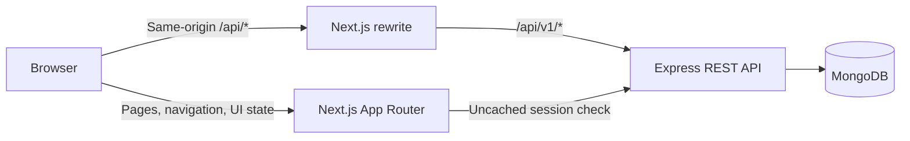

# Doctor Tracker frontend

## Elevator pitch

Doctor Tracker is a responsive admin workspace for finding doctors and patients, maintaining patient assignments, and reviewing clinic activity in a dashboard. This Next.js application provides the UI while a separate Express API owns authentication, validation, business rules, and database access.

## Features

- Admin login, protected pages, and logout with session-aware cache cleanup.
- Doctor directory with search, date and facet filters, pagination, create forms, and doctor detail pages.
- Global Patients page with search, condition/status/doctor/date filters, pagination, create/edit sheets, assignment changes, and confirmed deletion.
- Doctor detail pages with scoped patient lists and add/delete actions.
- Dashboard with four KPIs, date ranges, four Recharts visualizations, table alternatives, drilldowns, and recent patients.
- Light and dark themes, responsive navigation, loading/error/empty states, and keyboard-accessible chart alternatives.

## Architecture

The browser uses same-origin `/api/*` requests. In development, Next.js rewrites these requests to Express at `http://127.0.0.1:4000/api/v1/*`. The server-only `BACKEND_ORIGIN` also supports protected page session checks. Shared DTOs and Zod schemas are maintained in `packages/contracts`.



The frontend uses TanStack Query for server state, URL search parameters for list filters and dashboard range, and Recharts loaded on demand for the dashboard charts. Every chart has a text/table equivalent; individual condition and doctor values link to filtered or detail views.

## Local setup

Use Node.js 24 LTS, npm, and a reachable MongoDB 7 instance or Atlas cluster. Run commands from the workspace root:

```powershell
Copy-Item backend/.env.example backend/.env
Copy-Item frontend/.env.example frontend/.env.local
npm ci
```

Set `MONGODB_URI` and a unique `ADMIN_PASSWORD` in `backend/.env`. Keep the database on a private connection. The default `PUBLIC_APP_ORIGIN` is `http://localhost:3000`; keep it equal to the origin used by the browser. The frontend sample sets the server-only `BACKEND_ORIGIN` to `http://127.0.0.1:4000`.

Create indexes and the first Admin account, and optionally seed synthetic dashboard data:

```powershell
npm run indexes:deploy -w @doctor-tracker/backend
npm run admin:provision -w @doctor-tracker/backend
npm run dashboard:seed -w @doctor-tracker/backend
```

Start the backend and frontend together:

```powershell
npm run dev
```

Open <http://localhost:3000>. To start one app separately, use `npm run dev -w @doctor-tracker/backend` or `npm run dev -w frontend` from the workspace root. The root development command builds the shared contracts package before starting both apps.

## Environment variables

| Variable                                      | Used by                   | Purpose                                                                                               |
| --------------------------------------------- | ------------------------- | ----------------------------------------------------------------------------------------------------- |
| `BACKEND_ORIGIN`                              | Next.js server            | Private Express origin for rewrites and session checks; never expose it with a `NEXT_PUBLIC_` prefix. |
| `MONGODB_URI`                                 | Express                   | MongoDB connection string.                                                                            |
| `PUBLIC_APP_ORIGIN`                           | Express                   | Exact browser origin required for login, logout, and other mutations.                                 |
| `PORT`                                        | Express                   | API listen port; defaults to `4000`.                                                                  |
| `TRUST_PROXY_HOPS`                            | Express                   | Number of trusted reverse-proxy hops.                                                                 |
| `REPORTING_TIME_ZONE`                         | Express                   | Reporting calendar for date filters and dashboard buckets; defaults to `Asia/Dhaka`.                  |
| `ADMIN_EMAIL`, `ADMIN_PASSWORD`, `ADMIN_NAME` | Admin provisioning script | One-time values used only when creating the initial Admin account.                                    |

See [backend/.env.example](../backend/.env.example) and [frontend/.env.example](.env.example). Do not commit `.env` or `.env.local` files. Share demo access details through the submission channel rather than this README.

## Quality checks

From the workspace root:

```powershell
npm run lint
npm run typecheck
npm run build
npm run format:check
```

The integration suite uses a dedicated MongoDB database named exactly `doctor_tracker_test` and drops it before and after the run. Set `MONGODB_TEST_URI` to that disposable database before running `npm run test:integration`. Do not point it at development or production data.

## Technical decisions

### URL state and server-state cache

Search, filters, sorting, pagination, and dashboard date range live in the URL. This preserves refresh and back/forward navigation and makes filtered views shareable. TanStack Query owns remote data, request cancellation, freshness, and mutation invalidation. Patient changes invalidate patient, doctor, and dashboard views so assignment and count changes propagate consistently.

### Recharts loaded on demand

The four charts use Recharts for responsive axes, tooltips, and area, pie, and bar visualizations. Chart modules are dynamically loaded so they do not add chart code to the initial route bundle. Each visualization also has a semantic table or text alternative; drilldown links remain available outside the chart canvas for keyboard users.

## Visual evidence

The assignment calls for desktop and mobile screenshots. No screenshot files are currently included. Capture the following screens using synthetic data, then add the images under `docs/screenshots/` and replace this note with image links:

- Dashboard at desktop and mobile widths, including the selected date range and all four charts.
- Doctors directory and doctor detail with the scoped patient panel.
- Global Patients page and the patient edit sheet at desktop and mobile widths.
- Login page and one representative validation/error state.

## Deployment and submission

The release target must run the Next.js server and standalone Express API behind one browser-visible origin. Configure HTTPS, `BACKEND_ORIGIN`, `PUBLIC_APP_ORIGIN`, the actual `TRUST_PROXY_HOPS`, and a least-privileged database identity. Verify cookie issuance/forwarding and health endpoints through the production ingress. Include the live project URL, repository URL, screenshots, and demo access details through the agreed submission channel.

See the [REST contract](../backend/docs/API_CONTRACT.md), [frontend design](docs/DESIGN.md), and [full-stack plan](../docs/IMPLEMENTATION_PLAN.md) for details.
