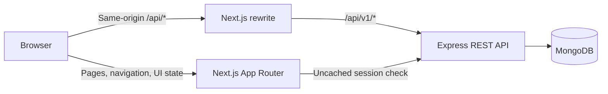
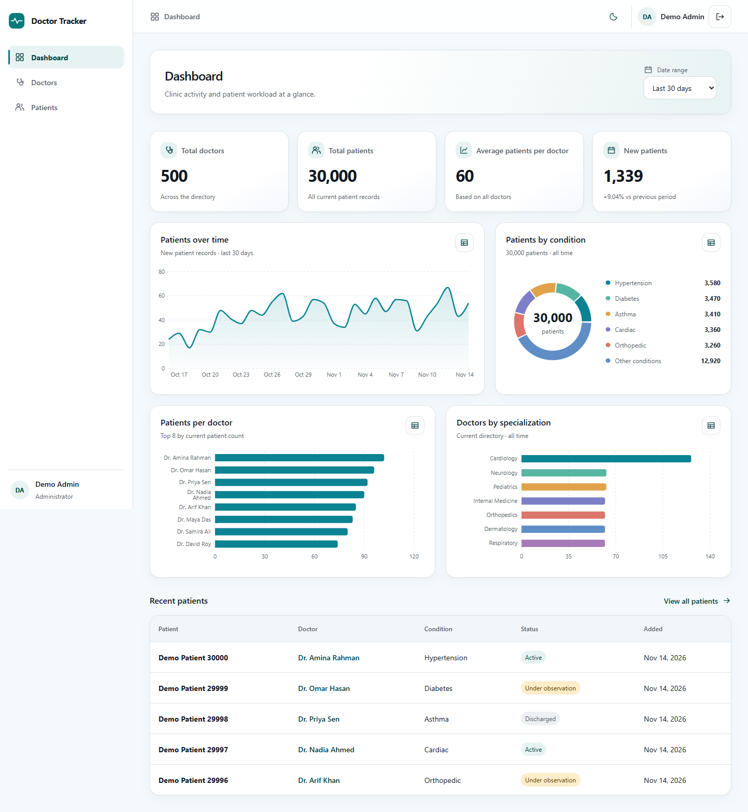
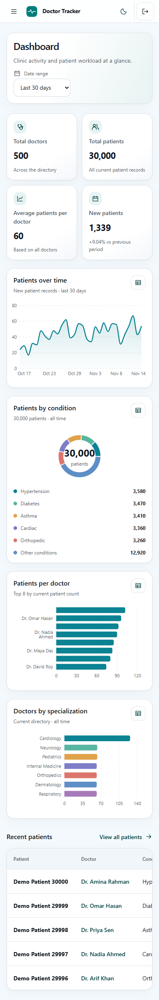
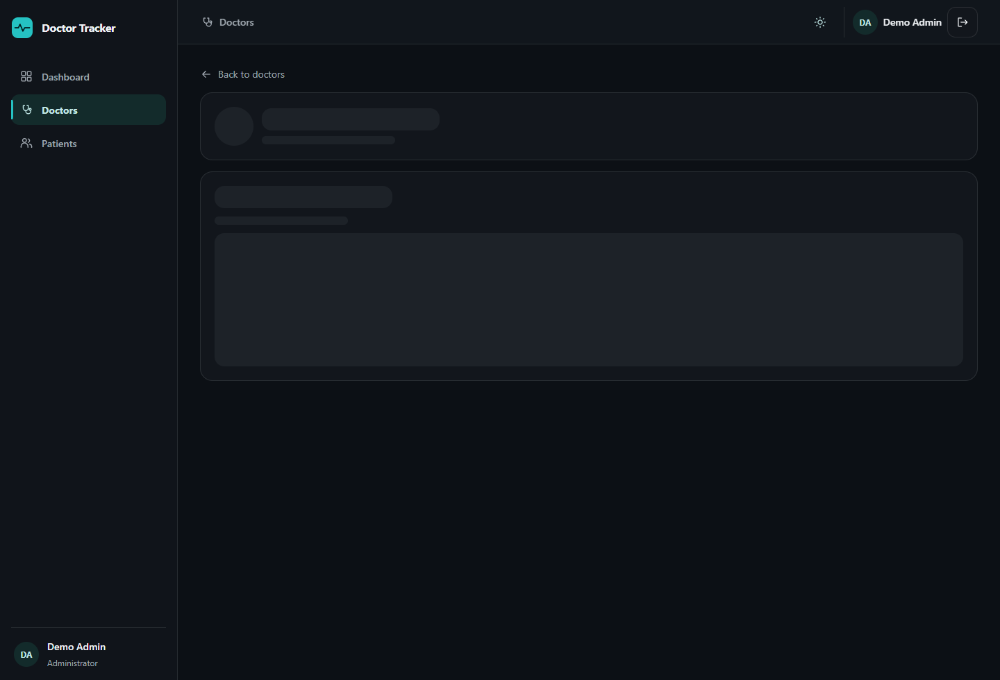
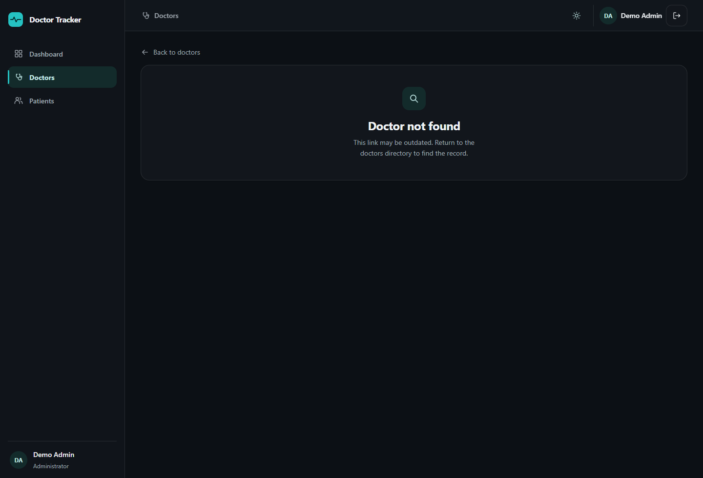
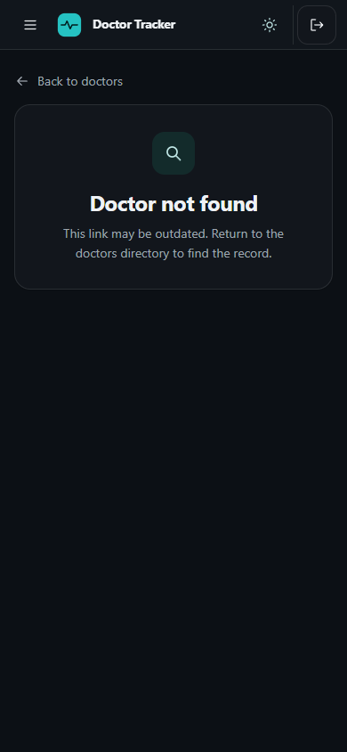

# Doctor Tracker frontend

## Elevator pitch

Doctor Tracker is a responsive admin workspace for finding doctors and patients, maintaining patient assignments, and reviewing clinic activity in a dashboard. This Next.js application provides the UI while a separate Express API owns authentication, validation, business rules, and database access.

Companion repository [Doctor Tracker backend](https://github.com/Mueem-Nahid/doctors-tracker-backend).

## Features

- Admin login, protected pages, and logout with session-aware cache cleanup.
- Doctor directory with search, date and facet filters, pagination, create forms, and doctor detail pages.
- Global Patients page with search, condition/status/doctor/date filters, pagination, create/edit sheets, assignment changes, and confirmed deletion.
- Doctor detail pages with scoped patient lists and add/delete actions.
- Dashboard with four KPIs, date ranges, four Recharts visualizations, table alternatives, drilldowns, and recent patients.
- Light and dark themes, responsive navigation, loading/error/empty states, and keyboard-accessible chart alternatives.

## Architecture

The browser uses same-origin `/api/*` requests. In development, Next.js rewrites these requests to Express at `http://127.0.0.1:4000/api/v1/*`. The server-only `BACKEND_ORIGIN` also supports protected page session checks. Shared DTOs and Zod schemas are maintained in `packages/contracts`.



The frontend uses TanStack Query for server state, URL search parameters for list filters and dashboard range, and Recharts loaded on demand for the dashboard charts. Every chart has a text/table equivalent; individual condition and doctor values link to filtered or detail views.

## Local setup

Use Node.js 24 LTS and npm. Clone the backend separately and start its API using the [backend setup guide](https://github.com/Mueem-Nahid/doctors-tracker-backend#local-setup). Set the backend's `PUBLIC_APP_ORIGIN` to `http://localhost:3000` for the default frontend address.

From this repository's root, run the following commands.

```powershell
npm ci
Copy-Item .env.example .env.local
npm run dev
```

Open <http://localhost:3000> and sign in with the admin account provisioned in the backend. The [sample configuration](.env.example) sets the server-only `BACKEND_ORIGIN` to `http://127.0.0.1:4000`. Update this value if the API listens elsewhere.

## Quality checks

From this repository's root, run the frontend checks.

```powershell
npm run lint
npm run typecheck
npm run build
npm run format:check
```

Run the [API integration suite](https://github.com/Mueem-Nahid/doctors-tracker-backend#verification) from the backend repository.

## Technical decisions

### URL state and server-state cache

Search, filters, sorting, pagination, and dashboard date range live in the URL. This preserves refresh and back/forward navigation and makes filtered views shareable. TanStack Query owns remote data, request cancellation, freshness, and mutation invalidation. Patient changes invalidate patient, doctor, and dashboard views so assignment and count changes propagate consistently.

### Recharts loaded on demand

The four charts use Recharts for responsive axes, tooltips, and area, pie, and bar visualizations. Chart modules are dynamically loaded so they do not add chart code to the initial route bundle. Each visualization also has a semantic table or text alternative; drilldown links remain available outside the chart canvas for keyboard users.

## Screenshots

The production frontend build was captured in Edge using synthetic API responses.

### Dashboard





### Doctor profile states







## Deployment and submission

Deploy this repository as a Next.js service. Set `BACKEND_ORIGIN` to the deployed API origin before building and starting Next.js. Use the public HTTPS frontend origin as `PUBLIC_APP_ORIGIN` in the backend. Verify sign-in, `/api/health/ready`, and sign-out through the deployed frontend. Submit the live frontend URL and both repository links. Share evaluator credentials privately when required.

See the [REST contract](https://github.com/Mueem-Nahid/doctors-tracker-backend/blob/main/docs/API_CONTRACT.md) and [frontend design](docs/DESIGN.md).
